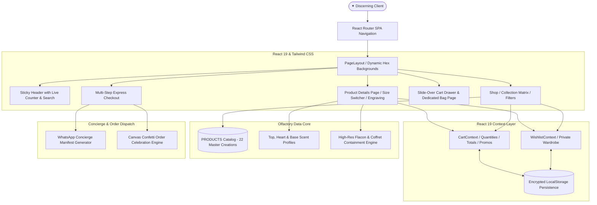

<div align="center">


# ⚜️ N O I R É L L E ⚜️
### *A World Beyond Fragrance • Haute Parfumerie & Luxury Digital Maison*

[](https://github.com/danishalipny-pixel/Luxury-Perfumes-02)
[](https://react.dev/)
[](https://www.typescriptlang.org/)
[](https://vitejs.dev/)
[](https://tailwindcss.com/)
[](https://github.com/danishalipny-pixel/Luxury-Perfumes-02)
[](https://github.com/danishalipny-pixel/Luxury-Perfumes-02)
[](LICENSE)

<br>

<p align="center">
  <strong>An uncompromising, museum-grade digital flagship crafted for an international luxury perfume house.</strong><br>
  Engineered with <strong>React 19</strong>, <strong>TypeScript Strict Mode</strong>, <strong>Vite 8</strong>, and <strong>Tailwind CSS</strong>.<br>
  Featuring 22 bespoke crystal flacons, 20 unique atmospheric background palettes, persistent luxury shopping cart & wishlist, interactive bottle customization with monogram engraving, and an express WhatsApp concierge checkout manifest.
</p>

<br>

[✦ Visual Showcase](#-haute-visual-showcase) • [✦ Olfactory Architecture](#-olfactory-pyramid--fragrance-realms) • [✦ Features Matrix](#-bespoke-features-suite) • [✦ System Architecture](#-system-architecture) • [✦ Quick Start](#-quick-start--installation) • [✦ Documentation](#-architectural-documentation)

---

</div>

## ✦ Brand Manifesto & Design Philosophy

> *"In the quiet space between memory and emotion lies NOIRÉLLE — not merely a fragrance, but an indelible personal presence."*

NOIRÉLLE was conceived as an editorial digital flagship that mirrors the prestige of Paris, Grasse, and the Orient. Moving beyond generic e-commerce templates, every single collection, product, and interactive touchpoint possesses its own distinct spatial atmosphere and color temperature:

* **Haute Horlogerie Precision:** Crisp luxury serif typography (*Cormorant Garamond* & *Playfair Display*) paired with clean modernist sans (*Inter* & *Manrope*).
* **20 Atmospheric Room Tones:** Meticulously calibrated hex palettes that shift naturally across collections to evoke the character of each olfactory family.
* **Dual-View Macro Flacon Study:** Every perfume flacon features dual photography that transitions on hover to reveal intimate details of the gold collar, atomizer, and crystal facets.
* **100% Genuine Perfume Imagery:** Zero room interiors, furniture, or lifestyle fillers. Every single card showcases genuine flacons and artisan coffrets with strict `object-contain` scaling.

---

## ✦ Atmospheric Palette Matrix (20 Calibrated Realms)

| Realm / View | Background Hex | Visual Ambiance & Atmospheric Character |
| :--- | :---: | :--- |
| **Cinematic Homepage** | `#F5F0E8` | Champagne Ivory • Warm editorial contrast & golden accents |
| **All Fragrances (Shop)** | `#FAF9F6` | Pearl White • Clean high-focus gallery catalog |
| **Homme Collection** | `#17191C` | Midnight Charcoal • Smoked obsidian & gold masculinity |
| **Femme Collection** | `#F3E8E5` | Dusty Rose • Warm Grasse May Rose Centifolia aura |
| **Unisexe Portfolio** | `#E8EDE5` | Muted Sage • Contemporary botanical mineral nuance |
| **Royal Oud & Agarwood**| `#211812` | Deep Espresso • Aged Cambodian oud, amber & frankincense |
| **Luxury Extraits** | `#131418` | Royal Velvet Noir • 24k gold leaf illumination |
| **Artisan Gift Coffrets**| `#EDE1CE`| Champagne Sand • Velvet-lined presentation chests |
| **Flacon Product Details**| `#F6F1E9` | Warm Ivory • High-focus tactile product study |
| **Slide-Over Cart Drawer**| `#151515` | Jet Black / Gold • Tactile slide-over flyout |
| **Shopping Cart View** | `#EAE5DC` | Warm Stone • Structured, calm checkout path |
| **Private Wishlist** | `#EEECF2` | Pale Lavender • Intimate olfactory wardrobe curation |
| **Concierge Checkout** | `#FBFAF7` | Clean Ivory • High-trust transactional confidence |
| **About the Atelier** | `#151515` | Luxury Black • Haute craftsmanship storytelling |
| **Order Confirmation** | `#EDF3EA` | Light Sage • Serene confetti-celebrated completion |

---

## ✦ Haute Visual Showcase

Every screenshot below is captured directly from the live application runtime:

<div align="center">

### 🏛️ Flagship Desktop Views

| 01 • Cinematic Homepage | 02 • Homme / Men's Line |
| :---: | :---: |
|  |  |

| 03 • Femme / Women's Line | 04 • Unisexe Botanical Line |
| :---: | :---: |
|  |  |

| 05 • Royal Oud & Agarwood | 06 • Master Gift Coffrets |
| :---: | :---: |
|  |  |

| 07 • Product Detail & Olfactory Notes | 08 • Persistent Cart Drawer & Bag |
| :---: | :---: |
|  |  |

| 09 • Curated Fragrance Wishlist | 10 • Concierge Checkout & WhatsApp |
| :---: | :---: |
|  |  |

<br>

### 📱 Responsive Mobile Flagship

<p align="center">
  
</p>

</div>

---

## ✦ Olfactory Pyramid & Fragrance Realms

```
                    ▲
                   / \
                  /   \
                 / TOP \
                / NOTES \
               /=========\
              /  HEART    \
             /   NOTES     \
            /===============\
           /      BASE       \
          /       NOTES       \
         /=====================\
```

* **Top Notes (First 15 Minutes):** Italian Bergamot, Pink Peppercorn, Saffron Threads, Blood Orange, White Peach.
* **Heart Notes (2 to 6 Hours):** Grasse May Rose Centifolia, Iris Florentina, Night-Blooming Jasmine, Ceylon Black Tea.
* **Base Notes (8 to 24+ Hours):** 25-Year Aged Cambodian Oud, Indonesian Patchouli, Smoked Vetiver, Royal Ambergris, Bourbon Vanilla.

### The Five Fragrance Houses

1. **L'Homme (Men's Haute Parfumerie):** Smoked vetiver root, charred French oak, Cuban tobacco leaf, and mineral cypress (*Ombre Sauvage, Nocturne Santal, Bois d'Argent*).
2. **La Femme (Women's Haute Parfumerie):** Velvet Grasse centifolia rose, golden Indian tuberose, white iris, and sparkling citrus blossoms (*Rose Velours, Fleur de Soie, Cristal de Lune*).
3. **L'Unisexe (Genderless Niche Creations):** Rare Ceylon tea, crushed cypress needles, warm Baltic amber, and white musk (*Thé Noir 29, Soleil Blanc, Cyprès d'Or*).
4. **Collection Royale Oud (Oriental & Arabic Agarwood):** Rare wild-harvested Cambodian agarwood, Taif rose petals, and golden frankincense (*Oud Royal, Sultan Oud, Oud Santal*).
5. **Les Coffrets d'Exception (Gift Sets & Discovery):** Piano-lacquered wooden presentation chests, espresso velvet duos, and discovery wardrobes (*Coffret Royal, Collection Découverte, Duo Oud*).

---

## ✦ Bespoke Features Suite

### 🛒 1. Enterprise Cart & Wishlist Architecture
- **Persistent LocalStorage State:** Cart items, chosen volumes, and wishlist bookmarks persist across sessions.
- **Complimentary Shipping Calculator:** Real-time progress bar computing remaining spend toward free worldwide white-glove delivery (\$150 threshold).
- **Promo Code Engine:** Validates promotional codes (`NOIRELLE10`, `VIP20`) with instant coupon deduction.
- **Slide-Over Flyout Drawer:** Seamless slide-out bag with instant quantity controls, thumbnail previews, and direct checkout route.

### 📱 2. WhatsApp Concierge Manifest Protocol
- **Direct VIP Concierge Ordering:** Clients can generate a pre-formatted, professional order manifest sent directly to a WhatsApp concierge.
- **Bespoke Order Serialization:** Encodes customer name, delivery address, selected items with flacon sizes, custom engraving text, and final total into a clean URL-encoded dispatch.

### 💎 3. Bottle Customization & Monogram Engraving Studio
- **Dynamic Flacon Sizes:** Switch seamlessly between 50ml, 100ml, and 200ml with live price recalculation.
- **Laser Engraving Simulation:** Add custom initials or sentimental messages (up to 20 characters) engraved in champagne gold on the crystal bottle.

### 🔍 4. Multi-Facet Olfactory Search & Filter Engine
- **Fragrance Family Filter:** Woody, Amber, Floral, Fresh, Citrus, Oriental, Spicy, and Musk.
- **Dynamic Price Range Slider:** Real-time price ceiling adjustments up to \$550.
- **Stock Status Filter:** Filter exclusively for available in-stock creations.
- **Instant Keyword Search:** Real-time debounced query filter matching title, notes, and family taxonomy.

---

## ✦ System Architecture



---

## ✦ Technology Stack & Engineering Standards

| Dimension | Technology | Version | Engineering Role |
| :--- | :--- | :---: | :--- |
| **Core Framework** | React | `^19.3.1` | Concurrent rendering, modern hooks, and transition primitives |
| **Language** | TypeScript | `~7.0.2` | 100% strict type safety across catalogs, orders, and context contracts |
| **Build System** | Vite | `^8.3.8` | Lightning-fast HMR and optimized production code splitting |
| **CSS Architecture** | Tailwind CSS | `^3.4.19` | Custom design tokens: champagne gold, ivory, obsidian & warm espresso |
| **Routing** | React Router | `^7.18.6` | Declarative SPA navigation and dynamic `/product/:slug` routes |
| **Iconography** | Lucide React | `^1.77.0` | Ultra-clean, scalable luxury vector icons |
| **Interactive FX** | Canvas Confetti | `^1.9.4` | Post-purchase particle celebratory burst |
| **Static Analysis** | Oxlint | `^1.90.0` | Ultra-fast linter (**0 errors, 0 warnings**) |
| **Bundle Efficiency** | Rolldown / Rollup | Latest | Sub-4.6s production build with optimized gzip footprint |

---

## ✦ Project Directory Tree

```
Luxury-Perfumes-02/
│
├── public/
│   ├── images/
│   │   ├── banners/          # Seasonal & collection editorial banners
│   │   ├── campaigns/        # Flagship campaign imagery
│   │   ├── categories/       # Fragrance family visual cards (amber, floral, woody...)
│   │   ├── collections/      # Collection heroes (men, women, unisex, oud, gift-sets)
│   │   ├── hero/             # Cinematic landing hero images
│   │   ├── logo/             # NOIRÉLLE vector emblems & gold wordmarks
│   │   ├── products/         # 22 luxury perfume flacons (primary & hover macro views)
│   │   │   └── gift-sets/    # Master presentation coffrets & discovery trios
│   │   └── social/           # High-resolution social graph assets
│   ├── favicon.svg
│   ├── robots.txt
│   └── sitemap.xml
│
├── src/
│   ├── components/
│   │   ├── cart/             # Slide-over CartDrawer component
│   │   ├── common/           # QuickViewModal, LuxuryLoader, Logo, WhatsAppFloat
│   │   ├── home/             # HeroBanner, FeaturedCollections, BrandStory, Discovery...
│   │   ├── layout/           # Sticky Navbar, Footer, AnnouncementBar, PageLayout
│   │   └── products/         # ProductCard with dual-image hover transition
│   ├── context/
│   │   ├── CartContext.tsx   # Global cart state, item counts, promo codes, totals
│   │   └── WishlistContext.tsx # Global private wishlist state & sync
│   ├── data/
│   │   ├── collections.ts    # Realm descriptions, background colors & accents
│   │   ├── products.ts       # Centralized 22 master perfume creations catalog
│   │   └── testimonials.ts   # Demonstration luxury client reviews
│   ├── pages/
│   │   ├── About/            # Maison philosophy & Grasse craftsmanship atelier
│   │   ├── Admin/            # Inventory & catalog showcase
│   │   ├── Cart/             # Dedicated responsive shopping bag page
│   │   ├── Checkout/         # Multi-step luxury checkout form
│   │   ├── Collections/      # Individual realm collection pages (Men, Women, Oud...)
│   │   ├── Contact/          # Concierge messaging & private appointment booking
│   │   ├── Home/             # Flagship storefront view
│   │   ├── NotFound/         # Custom 404 luxury error page
│   │   ├── OrderSuccess/     # Confetti-celebrated order confirmation
│   │   ├── OrderTracking/    # Real-time simulated order status tracking
│   │   ├── Policies/         # Shipping, Returns, Privacy, Terms legal policies
│   │   ├── ProductDetails/   # Dynamic flacon detail pages (/product/:slug)
│   │   ├── Search/           # Real-time search query resolver
│   │   ├── Shop/             # Complete catalog with multi-facet filters
│   │   └── Wishlist/         # Saved private wardrobe
│   ├── types/
│   │   ├── cart.ts           # Cart item, drawer, and promo interfaces
│   │   ├── order.ts          # Customer, shipping, and checkout data models
│   │   └── product.ts        # Typed fragrance, flacon size, and review contracts
│   ├── utils/
│   │   └── whatsapp.ts       # WhatsApp concierge manifest compiler
│   ├── App.tsx               # Route manifest definition
│   ├── index.css             # Tailwind layers, luxury typography & custom styles
│   └── main.tsx              # React DOM entry point
│
├── docs/
│   ├── images/               # High-resolution GitHub README banner
│   ├── screenshots/          # 12 real runtime captures (desktop & mobile)
│   ├── ARCHITECTURE.md       # Deep-dive system architecture specification
│   ├── DEPLOYMENT.md         # Vercel, Netlify, and Cloudflare Pages setup
│   ├── IMAGE_ASSETS.md       # Media guidelines & flacon aspect ratio standards
│   ├── INSTALLATION.md       # Local developer onboarding guide
│   ├── PROJECT_OVERVIEW.md   # Product scope & design philosophy
│   └── TESTING.md            # Static testing & verification scripts
│
├── .env.example              # Safe environment variable configuration template
├── .gitignore                # Production security & build output ignore rules
├── .oxlintrc.json            # Oxlint static analysis configuration
├── index.html                # HTML5 entry with luxury typography pre-connects
├── package.json              # Project dependencies and script runner
├── postcss.config.js         # PostCSS configuration
├── tailwind.config.js        # Custom champagne gold, ivory & noir color extensions
├── tsconfig.json             # Root TypeScript compilation configuration
└── vite.config.ts            # Vite optimization and plugin configuration
```

---

## ✦ Quick Start & Installation

### Prerequisites
- **Node.js**: `v18.0.0` or higher (`Node 20+` recommended)
- **Package Manager**: `npm`, `yarn`, or `pnpm`

### 1. Clone the Repository
```bash
git clone https://github.com/danishalipny-pixel/Luxury-Perfumes-02.git
cd Luxury-Perfumes-02
```

### 2. Install Dependencies
```bash
npm install
```

### 3. Setup Environment
```bash
cp .env.example .env
```

### 4. Launch Development Server
```bash
npm run dev
```
Open **`http://localhost:5174/`** (or `http://localhost:5173/`) in your browser to experience the boutique.

### 5. Production Build & Static Quality Audit
```bash
# Verify 0 linting warnings or errors
npm run lint

# Compile optimized production bundle
npm run build

# Preview production build locally
npm run preview
```

---

## ✦ Architectural Documentation

Explore the comprehensive technical specifications inside [`docs/`](docs/):

* [**PROJECT_OVERVIEW.md**](docs/PROJECT_OVERVIEW.md) — Product vision, brand philosophy, and aesthetic direction.
* [**ARCHITECTURE.md**](docs/ARCHITECTURE.md) — State architecture, context data flow, and React 19 standards.
* [**IMAGE_ASSETS.md**](docs/IMAGE_ASSETS.md) — Flacon photography registry, dimensions, and aspect ratio protocols.
* [**INSTALLATION.md**](docs/INSTALLATION.md) — Complete setup guide and environment variable configuration.
* [**DEPLOYMENT.md**](docs/DEPLOYMENT.md) — Vercel, Netlify, GitHub Pages, and Docker deployment guides.
* [**TESTING.md**](docs/TESTING.md) — Verification checklists and test patterns.

---

<div align="center">

### ⚜️ NOIRÉLLE ⚜️
*A World Beyond Fragrance.*

Crafted with passion and meticulous attention to detail by **Danish Rashid**.

[](https://github.com/danishalipny-pixel)
[](https://github.com/danishalipny-pixel/Luxury-Perfumes-02)

</div>
